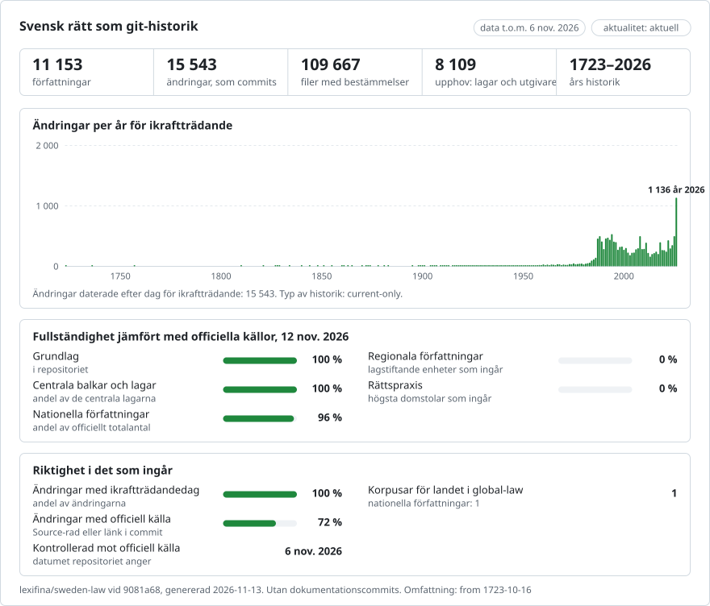

# Svenska författningar (SFS) som git-repositorium

**Svenska** · [English](README.en.md)

<picture>
<source media="(prefers-color-scheme: dark)" srcset="data/sv/effort-dark.svg">

</picture>

En del av [lexifina/global-law](https://github.com/lexifina/global-law), en enda git-historik för alla länders rätt: detta är Sveriges nationella författningar, som global-law läser under `sweden/national/acts/`.

Sveriges författningar publicerade i Svensk författningssamling (SFS), i den konsoliderade form som Regeringskansliet
tar fram (SFST) och som riksdagen publicerar som öppna data: 5 304 gällande författningar på `main`, från
regeringsformen (`1974/152`), brottsbalken (`1962/700`) och rättegångsbalken (`1942/740`) till de senaste
förordningarna, därtill 5 812 upphävda författningar i historiken (raderade den dag de upphävdes) och 37 författningar
som ännu inte har trätt i kraft på grenen `future`. Varje paragraf är en fil, med ett stycke per rad, så att `git blame`
och `git diff` fungerar rad för rad. Texten är på svenska, exakt som den har publicerats.

**Endast gällande lydelse.** Källorna har en konsolidering per författning ("t.o.m. SFS ...", till och med den senaste
ändringsförfattningen), inte tidigare versioner. Varje författning har därför en huvudtext, daterad till den dag då den
senaste ändringsförfattning som ingår i den trädde i kraft. Där utgivaren återger en bestämmelse i två daterade
lydelser ("/Upphör att gälla U:2027-01-01/" och "/Träder i kraft I:2027-01-01/") är ändringen en verklig daterad
commit som tillskrivs den författning som anges i slutet av den nya texten ("Lag (2026:1604)."), och en upphävd
författning raderas av den upphävande författningen den dag upphävandet gäller från. Varje paragraf behåller
utgivarens anteckning om vilken författning som senast gav den dess lydelse, och ändringsregistret (SFSR: varje
ändringsförfattning, vad den ändrade och när den trädde i kraft) finns i [`data/amendments.csv`](data/amendments.csv)
(69 678 rader, 67 679 ändringsförfattningar).

## En jurists frågor som git-kommandon

| Fråga | Kommando |
| --- | --- |
| Vad säger 3 kap. 1 § brottsbalken i dag? | `python tools/in_force_on.py 2026-10-28 1962/700/kap-3/1.md` |
| Hela regeringsformen, i ordning | `python tools/in_force_on.py 2026-10-28 1974/152` |
| Sedan när gäller denna text, och vilken författning står bakom den? | `git log --format='%(trailers:key=In-force,valueonly,separator=) %an' -- 1962/700/kap-3/1.md` |
| Vilken författning gav senast en paragraf dess lydelse? | anteckningen i slutet av paragrafen, t.ex. `Lag (2019:806).`; alla ändringar: `grep '^1962:700,' data/amendments.csv` |
| Vilka ändringar är redan beslutade, och när träder de i kraft? | `git log --format='%(trailers:key=In-force,valueonly,separator=) %s' main..future` |
| Allt som en författning ändrade, på alla grenar (här SFS 2026:1602) | `git log --stat --author='2026:1602' --all` |
| När upphävdes en författning, och genom vilken författning? | `git log --diff-filter=D --format='%(trailers:key=In-force,valueonly,separator=) %an' -- 1961/281` |
| Texten i en upphävd författning | `git log -1 --format=%H --diff-filter=D -- 1961/281` och sedan `git show <that>^:1961/281/1.md` |
| Vilka författningar hänvisar till upphovsrättslagen (1960:729)? | `git grep -l '(1960:729)'` |
| Förteckningen över författningar, med datum och status | [`laws.csv`](laws.csv) |

PowerShell: `$r = git log -1 --format=%H --diff-filter=D -- 1961/281; git show "$($r)^:1961/281/1.md"`.

Filer: `<year>/<number>/` per författning (SFS 1962:700 är `1962/700/`; äldre nummer som 1736:0123 2 är
`1736/0123-2/`). Paragrafer är `<n>.md`, eller `kap-<k>/<n>.md` i författningar som är indelade i kapitel (`kap-3/1.md`
är 3 kap. 1 §, `3a.md` är 3 a §). Text före den första paragrafen finns i `ingress.md`; övergångsbestämmelserna
(grupperade under numret på varje författning som lade till dem) finns i `overgang.md`, och bilagor efter dem i
`bilaga-<n>.md`. Rubriker (avdelning, kapitel och rubrikerna mellan paragraferna) är `#`-rader överst i den paragraf som
följer efter dem. `index.txt` anger läsordningen. I författningar vars källa saknar paragrafmärkning delas paragraferna
där ett stycke börjar med "<n> §".

## Datumen, och vilket vi använder

**Commits dateras till den dag då en text trädde i kraft**, kl. 12.00 Stockholmstid (CET, eller CEST under sommartid), i
trailern `In-force:` och som commit-datum. Varje författnings text dateras till ikraftträdandedagen för den senaste
ändringsförfattning som dess konsolidering omfattar, enligt SFSR-registret (`Date-source: sfsr-amendment`;
författningens egen ikraftträdandedag om ingenting har ändrat den, `sfsr-in-force`; utfärdandedagen där registret inte
anger någon ikraftträdandedag, `issued`). Daterade bestämmelser i två lydelser ändras på den angivna dagen (`marker`);
upphävanden på dagen som anges som Upphävd (`upphavd`). Datum före 1970 sätts till 1970-01-01 i git; den verkliga dagen
står i `In-force:`. `Issued:` är den dag då författningen utfärdades.

`tools/in_force_on.py DATE PATH` läser trailrarna `In-force:` och är därför inte beroende av din tidszon (till skillnad
från `git rev-list --before`). För tiden innan en författnings historik börjar anger verktyget att ingenting gäller.
Ändringar som träder i kraft efter 2026-10-28 finns på grenen `future` (485 commits; slås aldrig ihop med `main`).
Bestämmelser vars ikraftträdandedag är "den dag som regeringen bestämmer" (ännu inte fastställd) tillämpas ingenstans;
de förtecknas i [`data/undated.csv`](data/undated.csv) (623 markeringar).

## Vad "author" betyder

- **Utgivaren** (`Regeringskansliet SFST (via Riksdagen open data)`), `Kind: consolidated`: en författnings
  konsoliderade text, som många författningar har skrivit. `Last-amended-by:` anger den författning vars
  ikraftträdandedag daterar texten och `Amended-through:` den senaste författning som ingår. Använd anteckningarna i
  varje paragraf och `data/amendments.csv` för att se vem som skrev vad.
- **Författningen själv** (`Brottsbalk (1962:700) <sfs-1962-700@sfs.invalid>`), `Kind: enacted`: en författning som
  enligt registret inte har ändrats.
- **En ändringsförfattning** (`Lag (2026:1604) om ändring i brottsbalken <sfs-2026-1604@sfs.invalid>`), `Kind: amendment`:
  en daterad bestämmelse i två lydelser som ändras på sin dag; författningen är den som anges i slutet av den nya texten.
- **En upphävande författning**, `Kind: repeal`: författningens filer raderas den dag upphävandet gäller från.
- **Utgivaren**, `Kind: unexplained`: en daterad ändring som ingen enskild författning kan anges för (`Candidate:` anger
  de möjliga författningarna).

Commits per `Kind` på `main`: amendment 3, consolidated 6 669, enacted 4 447, repeal 4 416; på `future`: amendment 427, enacted 37, repeal 17, unexplained 4. Blame tillskriver hela stycken; använd
`git log -p --word-diff` för enskilda ord.

## Vad det inte visar

- Text före den aktuella konsolideringen: ingen tidigare lydelse av någon författning.
- Ändringar i en författning som dess konsolidering ännu inte omfattar (utgivarens text kan ligga efter registret).
- Författningar som utgivaren återger med odaterbara passager i två lydelser kring kapitel eller rubriker: de behålls
  som de är tryckta, med båda lydelserna, den andra i en fil med namnet `~2` (`Text: as-printed`; textklasser: as-printed 42, dated-versions 427, plain 10 684).
- Myndighetsföreskrifter, EU-rätt och rättspraxis; de 133 riksdagsförfattningarna från 1800-talet i samma serie av
  öppna data (OCR-text, inte SFS-författningar).
- Tabeller och formatering (kursiv stil); författningar som inte kunde läsas (387 rader i
  [`data/unreadable.csv`](data/unreadable.csv)).

Detta är ett hjälpmedel för forskning. Den auktoritativa texten är den som publiceras i Svensk författningssamling.

## Hur det kontrolleras

check_repo.py läste tillbaka varje version av varje författning (11 541 versioner, 20 276 783 ord, på `main` och `future`) och jämförde dess bokstäver och siffror med råkällan: fältet med ren text i Riksdagens JSON för författningar utan daterade lydelser (text som build.py aldrig läser), och för författningar med daterade bestämmelser i två lydelser HTML-texten genom en separat, minimal extraktor, där de passager som gällde på versionens dag behölls: 0 avvikelser. 15 536 commits på main och 485 på future: 0 vars trailers git inte kan tolka, 0 utan In-force, 0 merges, 0 In-force-datum som går bakåt, 0 efter byggdagen på main, 0 CR-tecken i meddelandena. test_repo.py (blame, datumverktyget före och efter daterade ändringar och ett upphävande, ordningen i log --follow, In-force på varje commit, upphovsuppgifter, varje kommando i README): 6/6 godkända. Resultaten kommer från det föregående bygget från samma cache; det nya bygget som skrev denna fil var hash-identiskt.

## Hur det byggs

`fetch.py` läser Riksdagens dokumentlista (doktyp=sfs), varje författnings `dokumentstatus`-JSON (den konsoliderade
texten som HTML och som ren text) och dess SFSR-sida på rkrattsbaser.gov.se. `build.py` delar upp varje text vid dess
paragrafankare, daterar den utifrån registret och skriver allt med en enda `git fast-import`-ström. Ingen AI-modell
deltar i att bygga eller kontrollera repositoriet. Se [`REPRODUCE.md`](REPRODUCE.md).

## Licens

Källa: Sveriges riksdag, Riksdagens öppna data, https://data.riksdagen.se, vars villkor lyder "Riksdagens öppna data
är fria att användas och spridas vidare så länge du anger källa." De konsoliderade texterna är Regeringskansliets
(SFST, https://rkrattsbaser.gov.se), och ändringsregistret är SFSR från samma webbplats. Denna tjänst tillhandahålls inte
av och är inte godkänd av Sveriges riksdag eller Regeringskansliet. Författningar omfattas inte av upphovsrätt i
Sverige: 1 kap. 9 § upphovsrättslagen (1960:729), som i detta repositorium (`1960/729/kap-1/9.md`): "9 § Upphovsrätt gäller inte till 1. författningar, 2. beslut av myndigheter, 3. yttranden av svenska myndigheter och 4. officiella översättningar av sådant som avses i 1-3. Upphovsrätt gäller dock till verk vilka ingår i en handling som avses i första stycket och är av följande slag: 1. kartor, 2. alster av bildkonst, 3. musikaliska verk eller 4. diktverk. Upphovsrätt gäller även till ett verk som ingår i en bilaga till ett beslut av en myndighet, om beslutet avser rätten att ta del av den allmänna handling där verket ingår. Lag (2000:92)." Lydelsen har inte ändrats; den har endast delats upp i filer och rader. **Detta
repositorium är privat.** Lexifinas egna bidrag (verktygen, strukturen och commit-meddelandena) omfattas av CC0. Se
[`LICENSE`](LICENSE).

Detta är en översättning av den engelska versionen ([README.en.md](README.en.md)); om de skiljer sig åt gäller den engelska versionen.

## Mer

Från repositoriet [lexifina/global-law](https://github.com/lexifina/global-law) (på engelska):

- [FEATURES.md](https://github.com/lexifina/global-law/blob/main/FEATURES.md): alla funktioner och vad varje korpus måste stödja (`git blame`, `law.py`, MCP-verktyg)
- [FAQ.md](https://github.com/lexifina/global-law/blob/main/FAQ.md): frågor och svar · [CONTRIBUTING.md](https://github.com/lexifina/global-law/blob/main/CONTRIBUTING.md): föreslå ändringar · [MCP.md](https://github.com/lexifina/global-law/blob/main/MCP.md): MCP-server · [REPRODUCE.md](https://github.com/lexifina/global-law/blob/main/REPRODUCE.md): hur det är byggt · [CHANGELOG.md](https://github.com/lexifina/global-law/blob/main/CHANGELOG.md)
- [FRESHNESS.md](https://github.com/lexifina/global-law/blob/main/FRESHNESS.md): hur aktuellt varje korpus är · [Övervakning](https://github.com/lexifina/global-law/tree/main/monitoring): om uppdateringarna fungerar · [WATCHING.md](https://github.com/lexifina/global-law/blob/main/WATCHING.md): hur varje officiell källa bevakas för ändringar
- [performance/](https://github.com/lexifina/global-law/tree/main/performance): hur snabba verktygen är, uppmätt
- [visualisations/](https://github.com/lexifina/global-law/tree/main/visualisations): diagram och kopplingar över hela världens rätt
- [Sårbarheter](https://github.com/lexifina/global-law/tree/main/vulnerabilities): fel i författningar så som de publicerats
